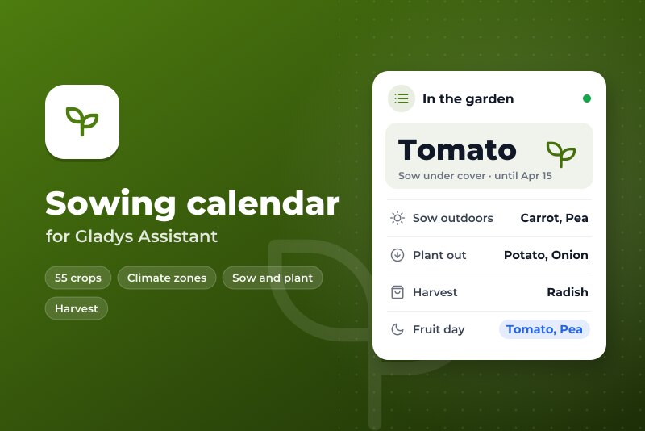
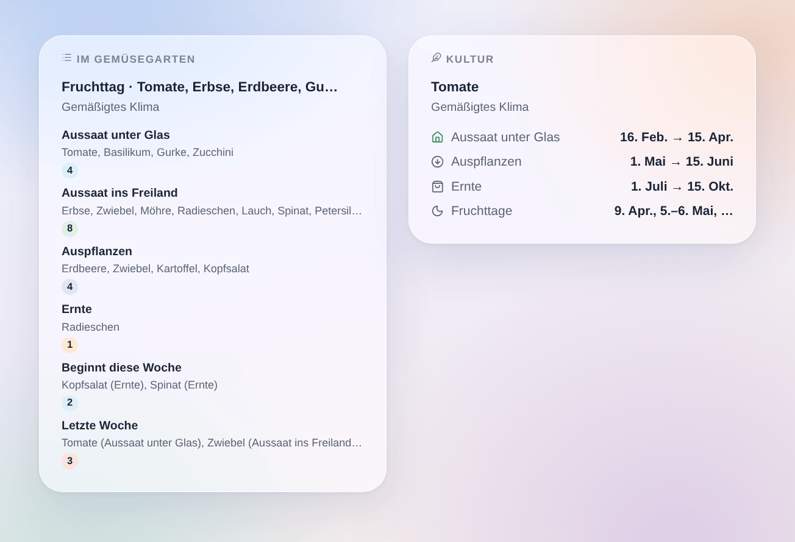
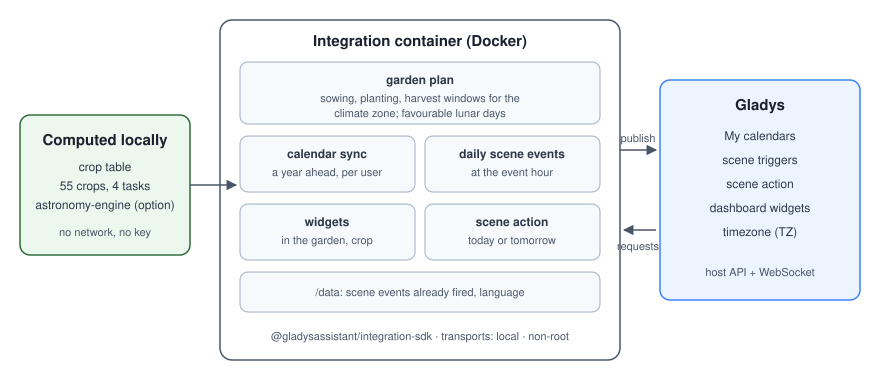
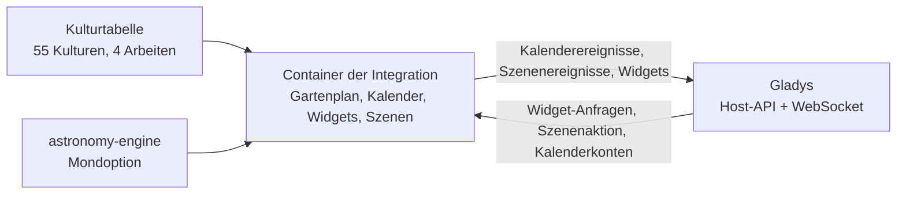
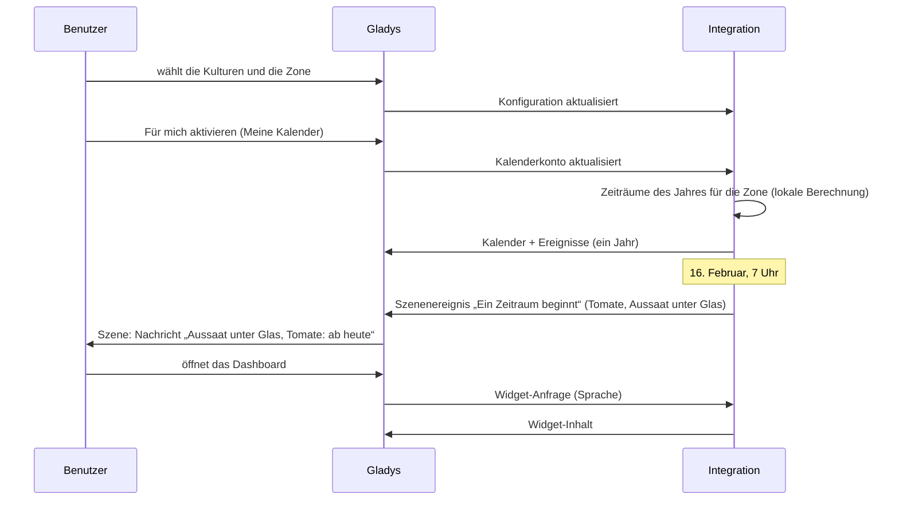

# Gladys Aussaatkalender

[English](README.md) · [Français](README.fr.md) · **Deutsch** · [Español](README.es.md)

[](LICENSE)
[](https://github.com/William-De71/gladys-sowing-calendar/releases)
[](https://github.com/William-De71/gladys-sowing-calendar/actions/workflows/release.yml)
[](https://gladysassistant.com)



Externe Integration für [Gladys Assistant](https://gladysassistant.com), die einen Aussaatkalender für den Gemüsegarten bringt: wann 55 Gemüse und Kräuter unter Glas oder ins Freiland gesät, ausgepflanzt und geerntet werden, mit Daten passend zu Ihrem Klima. Alles wird lokal berechnet, ohne Konto und ohne Verbindung, optional mit den günstigen Tagen des Mondkalenders für den Garten.

Benutzerdokumentation: [English](docs/en.md) · [Français](docs/fr.md) · [Deutsch](docs/de.md) · [Español](docs/es.md).

## Funktionen

- Ein **„Aussaatkalender“** unter „Meine Kalender“ für jeden Benutzer, der ihn aktiviert: ein Ereignis pro Kultur und Arbeit über den ganzen Zeitraum („Aussaat unter Glas: Tomate“, 16. Februar bis 15. April), von einer Woche zurück bis ein Jahr voraus, in der Sprache jedes Benutzers.
- **55 Kulturen** zum Auswählen (43 Gemüse, 12 Kräuter) und **4 Arbeiten**: Aussaat unter Glas, Aussaat ins Freiland, Auspflanzen, Ernte.
- **Ihr Klima**: fünf Klimazonen, die Frühjahr und Herbst vor- oder zurückverschieben, eine Feineinstellung in Wochen, die Südhalbkugel.
- **Optional der Mond**: die Frucht-, Wurzel-, Blüten- oder Blatttage, die zu jeder Kultur passen (Methode Maria Thun), ohne ungünstige Tage.
- **Szenenauslöser** „Tageszusammenfassung“, „Ein Zeitraum beginnt“ und „Letzte Woche eines Zeitraums“, mit Filtern. **Szenenaktion** „Gartenarbeiten abrufen“ (heute oder morgen), mit einem fertigen Satz.
- **Widgets** „Im Gemüsegarten“ (die Arbeiten des Tages) und „Kultur“ (die Daten einer Kultur).
- Nur lokal, vier Sprachen: Englisch, Französisch, Deutsch, Spanisch.



| Typ      | Name                         | Verwendung                                                                  |
| -------- | ---------------------------- | --------------------------------------------------------------------------- |
| Kalender | Aussaatkalender              | Ein Zeitraum pro Kultur und Arbeit, ein Jahr voraus                         |
| Widget   | Im Gemüsegarten              | Die laufenden Arbeiten, was diese Woche beginnt, was endet                  |
| Widget   | Kultur                       | Die Daten einer Kultur, laufend oder demnächst, und ihre nächsten Mondtage  |
| Auslöser | Tageszusammenfassung         | Jeden Tag zur gewählten Stunde (Filter: ein Zeitraum beginnt, Mondtagestyp) |
| Auslöser | Ein Zeitraum beginnt         | Der erste Tag eines Zeitraums (Filter: Arbeiten, Kulturen)                  |
| Auslöser | Letzte Woche eines Zeitraums | Sieben Tage vor dem Ende eines Zeitraums (Filter: Arbeiten, Kulturen)       |
| Aktion   | Gartenarbeiten abrufen       | Heute oder morgen: 14 Werte und ein Satz als Zusammenfassung                |

Es gibt keine Geräte: Gladys lässt eine Kalenderintegration keine Geräte veröffentlichen, und ein Aussaatzeitraum liest sich besser im Kalender, in den Widgets und Szenen.

## Funktionsweise







Die Kulturtabelle (`src/crops.js`) gibt pro Halbmonat die üblichen Zeiträume französischer Gartenkalender für ein gemäßigtes Klima an. `src/plan.js` verschiebt sie nach der Zone (ein Datum bis zum 15. Juli folgt der Frühjahrsverschiebung, ein späteres der Herbstverschiebung), der Feineinstellung und der Halbkugel. Die Mondoption nutzt den Almanach der Integration „Lunar gardening calendar“, Tag für Tag mit einem veröffentlichten Kalender geprüft.

Transport: **lokal**. Nichts verlässt Ihr Netzwerk.

## Voraussetzungen

- Gladys Assistant **5.3.0** oder neuer (Kalenderintegrationen, Katalog-Schlüsselwörter von Gladys 5.3). Ältere Instanzen können sie nicht installieren.
- Die richtige Zeitzone in Gladys: Die Tage wechseln um Mitternacht in dieser Zeitzone.

## Installation

1. Öffnen Sie in Gladys **Integrationen**, suchen Sie **Sowing calendar** und installieren Sie sie.
2. Wählen Sie Ihre Kulturen und Ihre Klimazone, dann klicken Sie unter **Meine Kalender** auf **Für mich aktivieren**; teilen Sie den Kalender mit dem Haushalt, um ihn in Szenen zu nutzen.
3. Fügen Sie die Widgets einem Dashboard hinzu und erstellen Sie Szenen mit den Auslösern und der Aktion. Die Einstellungen sind in der [Dokumentation](docs/de.md#konfiguration) beschrieben.

Über die URL des Repositorys oder im Entwicklermodus: siehe die Gladys-Dokumentation zu externen Integrationen.

## Entwicklung

```bash
npm install
npm test                       # node --test, nie mit Netzwerkzugriff
npm run lint && npm run format:check
npx github:GladysAssistant/integration-store . --skip-image-check
node scripts/sync-crops.mjs    # Kulturlisten des Manifests aus src/crops.js
scripts/build-cover.sh         # cover.jpg aus docs/assets/cover.svg
docs/illustrations/render.sh   # docs/assets/widgets.<Sprache>.png
node .github/scripts/release.mjs next
```

Lokal liest das SDK `GLADYS_HOST_API_URL`, `GLADYS_INTEGRATION_TOKEN` und `GLADYS_INTEGRATION_SELECTOR`, und `TZ` legt die Zeitzone der Tage fest; `DEBUG=gladys-integration-sdk` zeigt die Protokolle des SDK und prüft jeden Widget-Inhalt. Die Regeln des Projekts stehen in [CLAUDE.md](CLAUDE.md).

## Release-Prozess


Jeder Merge auf `main` startet die CI und berechnet dann die Version aus den [Conventional Commits](https://www.conventionalcommits.org/de/) seit dem letzten Tag: `feat` → Minor, `fix` / `perf` → Patch, `!` oder `BREAKING CHANGE` → Major (Minor vor 1.0.0); `docs`, `chore`, `ci`, `test`, `style`, `refactor`, `build` allein veröffentlichen nichts. Der Changelog-Abschnitt wird erzeugt, der Tag gepusht, das Multi-Architektur-Image gebaut, dann erhält `main` den Release-Commit, das GitHub Release wird erstellt und ein letzter Job prüft das öffentliche Image, den Store-Validator und das Topic.

- Der Titel des Pull Requests wird zum Squash-Commit und dann zur Changelog-Zeile: Schreiben Sie ihn auf Englisch, für den Benutzer (`pr-title.yml` prüft ihn). Bearbeiten Sie `CHANGELOG.md` nie von Hand.
- 1.0.0 ist eine Entscheidung: Actions → Release → Run workflow mit `release-as: 1.0.0`. `dry-run` zeigt Version und Notizen, ohne etwas zu veröffentlichen.
- Das Ruleset des Branches verbietet nur das Löschen und Force-Push: Eine Regel, die Pull Requests oder Status-Checks verlangt, würde den Release-Commit blockieren (lassen Sie GitHub Actions sie umgehen oder nutzen Sie eine GitHub App).
- Machen Sie nach dem ersten Release das Paket `ghcr.io` öffentlich (Package settings → Change visibility), sonst kann Gladys es nicht herunterladen.

## Mitwirken

Issues und Pull Requests sind willkommen. Führen Sie `npm run format:check && npm run lint && npm test` aus, bevor Sie einen Pull Request öffnen, und ändern Sie nie einen gespeicherten Schlüssel (Kulturschlüssel, Ereignis-IDs, Schlüssel der Auslöser und der Aktion: siehe [CLAUDE.md](CLAUDE.md)). Ein Datum scheint für eine Kultur falsch: Eröffnen Sie ein Issue mit der Kultur, der Arbeit und den erwarteten Daten, möglichst mit Quelle.

## Sicherheit

Siehe [SECURITY.md](SECURITY.md): Melden Sie Schwachstellen vertraulich. Die Integration hat kein Geheimnis, macht keinen Netzwerkaufruf und läuft schreibgeschützt, ohne Root-Rechte, in ihrem Container.

## Lizenz

[Apache-2.0](LICENSE). Die Mondoption nutzt [astronomy-engine](https://github.com/cosinekitty/astronomy) (MIT): siehe [NOTICE](NOTICE). Ohne Verbindung zu den Verlagen von Maria Thun, Demeter oder icalendrier.fr.
