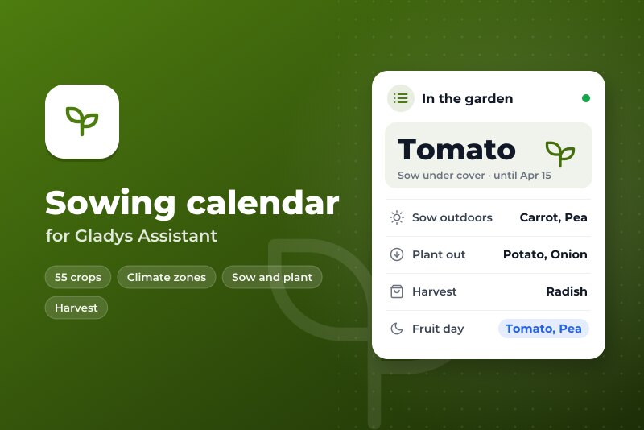
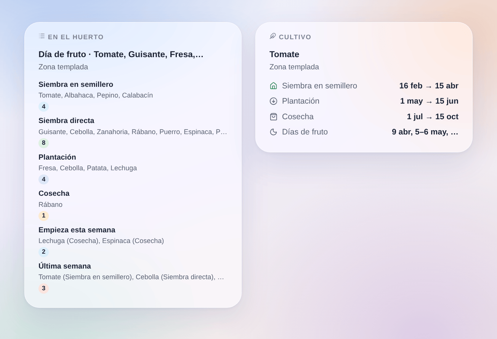
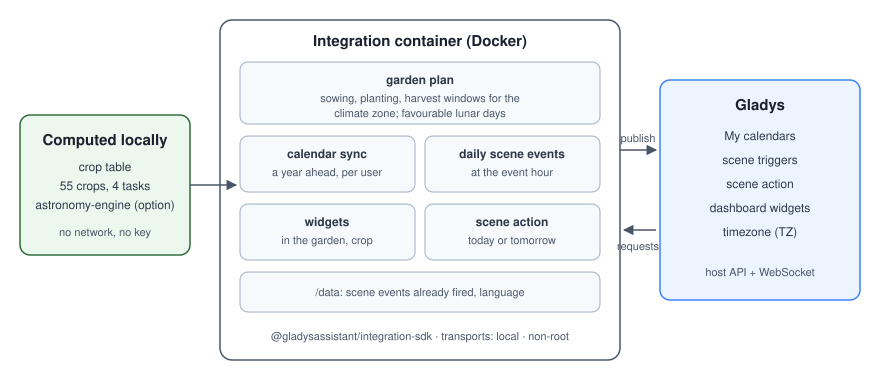
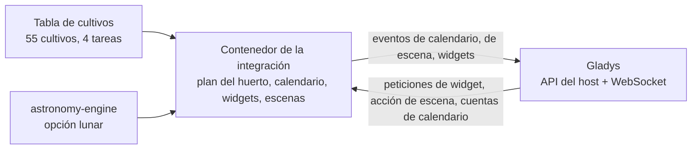
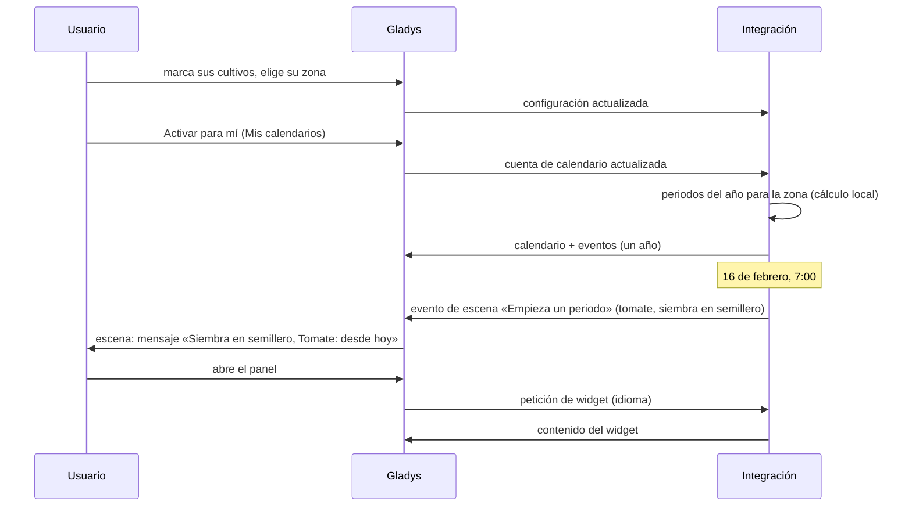

# Gladys Calendario de siembra

[English](README.md) · [Français](README.fr.md) · [Deutsch](README.de.md) · **Español**

[](LICENSE)
[](https://github.com/William-De71/gladys-sowing-calendar/releases)
[](https://github.com/William-De71/gladys-sowing-calendar/actions/workflows/release.yml)
[](https://gladysassistant.com)



Integración externa para [Gladys Assistant](https://gladysassistant.com) que aporta un calendario de siembra para el huerto: cuándo sembrar en semillero, sembrar directamente, plantar y cosechar 55 hortalizas y aromáticas, con fechas adaptadas a su clima. Todo se calcula localmente, sin cuenta ni conexión, y opcionalmente con los días favorables del calendario lunar del huerto.

Documentación de usuario: [English](docs/en.md) · [Français](docs/fr.md) · [Deutsch](docs/de.md) · [Español](docs/es.md).

## Funcionalidades

- Un **«Calendario de siembra»** en «Mis calendarios» para cada usuario que lo active: un evento por cultivo y tarea durante todo su periodo («Siembra en semillero: Tomate», del 16 de febrero al 15 de abril), de una semana atrás a un año adelante, en el idioma de cada usuario.
- **55 cultivos** para marcar (43 hortalizas, 12 aromáticas) y **4 tareas**: siembra en semillero, siembra directa, plantación, cosecha.
- **Su clima**: cinco zonas climáticas que adelantan o retrasan la primavera y el otoño, un ajuste fino en semanas, el hemisferio sur.
- **Opcionalmente, la luna**: los días de fruto, raíz, flor u hoja adecuados para cada cultivo (método Maria Thun), sin los días desfavorables.
- **Disparadores de escena** «Resumen del día», «Empieza un periodo» y «Última semana de un periodo», con filtros. **Acción de escena** «Obtener las tareas del huerto» (hoy o mañana), con una frase lista.
- **Widgets** «En el huerto» (las tareas del día) y «Cultivo» (las fechas de un cultivo).
- Solo local, cuatro idiomas: inglés, francés, alemán, español.



| Tipo       | Nombre                        | Uso                                                                         |
| ---------- | ----------------------------- | --------------------------------------------------------------------------- |
| Calendario | Calendario de siembra         | Un periodo por cultivo y tarea, un año adelante                             |
| Widget     | En el huerto                  | Las tareas en curso, lo que empieza esta semana, lo que termina             |
| Widget     | Cultivo                       | Las fechas de un cultivo, en curso o próximas, y sus próximos días lunares  |
| Disparador | Resumen del día               | Cada día a la hora elegida (filtros: empieza un periodo, tipo de día lunar) |
| Disparador | Empieza un periodo            | El primer día de un periodo (filtros: tareas, cultivos)                     |
| Disparador | Última semana de un periodo   | Siete días antes del final de un periodo (filtros: tareas, cultivos)        |
| Acción     | Obtener las tareas del huerto | Hoy o mañana: 14 valores y una frase de resumen                             |

No hay dispositivos: Gladys no deja que una integración de calendario publique dispositivos, y un periodo de siembra se lee mejor en el calendario, los widgets y las escenas.

## Funcionamiento







La tabla de cultivos (`src/crops.js`) da, por quincena, los periodos habituales de los calendarios de huerto franceses para un clima templado. `src/plan.js` los desplaza según la zona (una fecha hasta el 15 de julio sigue el desplazamiento de primavera, una posterior el de otoño), el ajuste fino y el hemisferio. La opción lunar usa el almanaque de la integración «Lunar gardening calendar», comprobado día a día con un calendario publicado.

Transporte: **local**. Nada sale de su red.

## Requisitos

- Gladys Assistant **5.3.0** o posterior (integraciones de calendario, palabras clave del catálogo de Gladys 5.3). Las instancias anteriores no pueden instalarla.
- La zona horaria correcta en Gladys: los días cambian a medianoche en esta zona.

## Instalación

1. En Gladys, abra **Integraciones**, busque **Sowing calendar** e instálela.
2. Marque sus cultivos, elija su zona climática y haga clic en **Activar para mí** en **Mis calendarios**; comparta el calendario con el hogar para usarlo en escenas.
3. Añada los widgets a un panel y cree escenas con los disparadores y la acción. Los ajustes se describen en la [documentación](docs/es.md#configuración).

Desde la URL del repositorio, o en modo desarrollador: vea la documentación de Gladys sobre integraciones externas.

## Desarrollo

```bash
npm install
npm test                       # node --test, nunca toca la red
npm run lint && npm run format:check
npx github:GladysAssistant/integration-store . --skip-image-check
node scripts/sync-crops.mjs    # listas de cultivos del manifiesto desde src/crops.js
scripts/build-cover.sh         # cover.jpg desde docs/assets/cover.svg
docs/illustrations/render.sh   # docs/assets/widgets.<idioma>.png
node .github/scripts/release.mjs next
```

En local, el SDK lee `GLADYS_HOST_API_URL`, `GLADYS_INTEGRATION_TOKEN` y `GLADYS_INTEGRATION_SELECTOR`, y `TZ` fija la zona horaria de los días; `DEBUG=gladys-integration-sdk` muestra los registros del SDK y comprueba cada contenido de widget. Las reglas del proyecto están en [CLAUDE.md](CLAUDE.md).

## Proceso de release


Cada fusión en `main` lanza la CI y luego calcula la versión a partir de los [Conventional Commits](https://www.conventionalcommits.org/es/) desde la última etiqueta: `feat` → menor, `fix` / `perf` → parche, `!` o `BREAKING CHANGE` → mayor (menor antes de 1.0.0); `docs`, `chore`, `ci`, `test`, `style`, `refactor`, `build` solos no publican nada. Se genera la sección del changelog, se empuja la etiqueta, se construye la imagen multiarquitectura, luego `main` recibe el commit de release, se crea la GitHub Release y un último job comprueba la imagen pública, el validador del store y el topic.

- El título de la pull request se convierte en el commit squash y luego en la línea del changelog: escríbalo en inglés, para el usuario (`pr-title.yml` lo comprueba). No edite nunca `CHANGELOG.md` a mano.
- 1.0.0 es una decisión: Actions → Release → Run workflow con `release-as: 1.0.0`. `dry-run` muestra la versión y las notas sin publicar nada.
- **Rama protegida**: unos rulesets exigen una pull request en `main` y bloquean las etiquetas `v*`; solo pasan el mantenedor y las deploy keys. La publicación hace push con la deploy key del entorno `release` (secreto `RELEASE_DEPLOY_KEY`, solo `main`): una ejecución lanzada desde otra rama nunca la obtiene. `build.yml` y `github-release.yml` no arrancan con una etiqueta: la publicación los llama, o lánzelos a mano (Actions → Run workflow, con `version` para la imagen) para terminar una publicación.
- Tras la primera release, haga público el paquete `ghcr.io` (Package settings → Change visibility), si no Gladys no puede descargarlo.

## Contribuir

Issues y pull requests son bienvenidas. Ejecute `npm run format:check && npm run lint && npm test` antes de abrir una pull request, y no cambie nunca una clave guardada (claves de cultivos, identificadores de eventos, claves de los disparadores y de la acción: vea [CLAUDE.md](CLAUDE.md)). Una fecha parece errónea para un cultivo: abra una issue con el cultivo, la tarea y las fechas que espera, con una fuente si puede.

## Seguridad

Vea [SECURITY.md](SECURITY.md): informe de las vulnerabilidades en privado. La integración no tiene ningún secreto, no hace ninguna llamada de red y se ejecuta en solo lectura, sin derechos de root, en su contenedor.

## Licencia

[Apache-2.0](LICENSE). La opción lunar usa [astronomy-engine](https://github.com/cosinekitty/astronomy) (MIT): vea [NOTICE](NOTICE). Sin relación con las editoriales de Maria Thun, Demeter ni icalendrier.fr.
