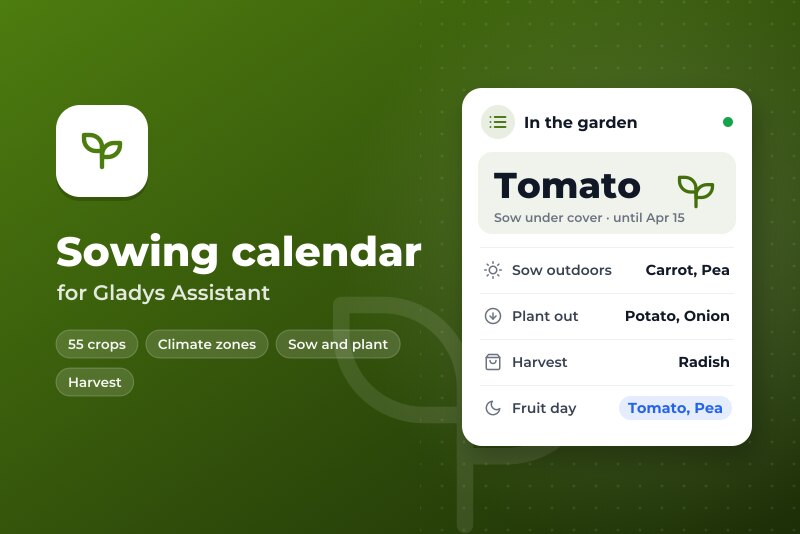
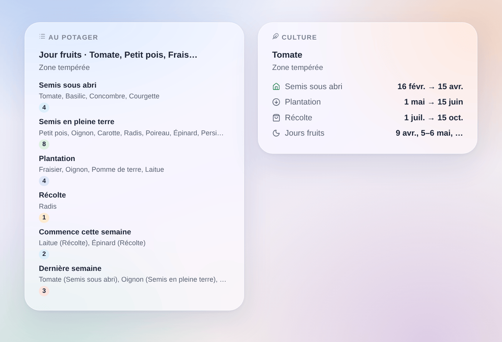
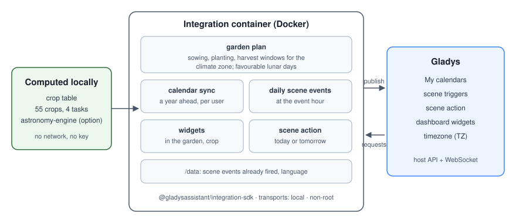
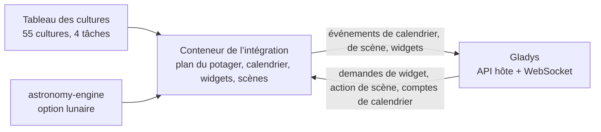
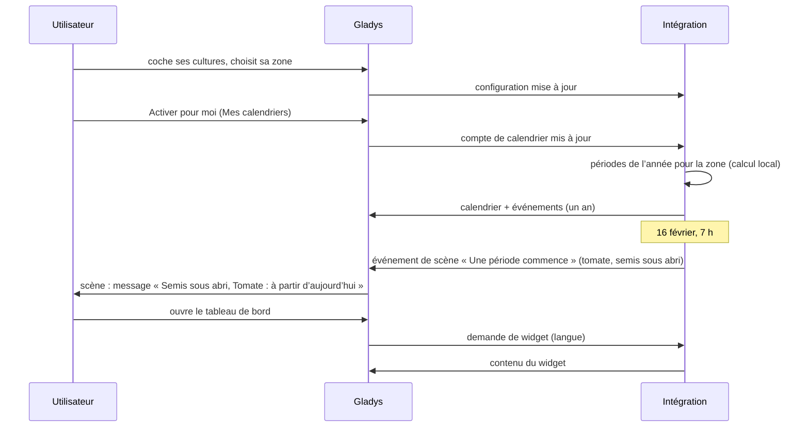

# Gladys Calendrier des semis

[English](README.md) · **Français** · [Deutsch](README.de.md) · [Español](README.es.md)

[](LICENSE)
[](https://github.com/William-De71/gladys-sowing-calendar/releases)
[](https://github.com/William-De71/gladys-sowing-calendar/actions/workflows/release.yml)
[](https://gladysassistant.com)



Intégration externe de [Gladys Assistant](https://gladysassistant.com) qui apporte un calendrier des semis pour le potager : quand semer sous abri, semer en pleine terre, planter et récolter 55 légumes et aromatiques, avec des dates adaptées à votre climat. Tout est calculé localement, sans compte ni connexion, avec en option les jours favorables du calendrier lunaire du jardinier.

Documentation utilisateur : [English](docs/en.md) · [Français](docs/fr.md) · [Deutsch](docs/de.md) · [Español](docs/es.md).

## Fonctionnalités

- Un **« Calendrier des semis »** dans « Mes calendriers » pour chaque utilisateur qui l’active : un événement par culture et par tâche sur toute sa période (« Semis sous abri : Tomate », du 16 février au 15 avril), d’une semaine en arrière à un an en avant, dans la langue de chaque utilisateur.
- **55 cultures** à cocher (43 légumes, 12 aromatiques) et **4 tâches** : semis sous abri, semis en pleine terre, plantation, récolte.
- **Votre climat** : cinq zones climatiques qui avancent ou retardent le printemps et l’automne, un réglage fin en semaines, l’hémisphère sud.
- **En option, la lune** : les jours fruits, racines, fleurs ou feuilles qui conviennent à chaque culture (méthode Maria Thun), hors jours à éviter.
- **Déclencheurs de scène** « Résumé du jour », « Une période commence » et « Dernière semaine d’une période », avec des filtres. **Action de scène** « Obtenir les travaux du potager » (aujourd’hui ou demain), avec une phrase toute prête.
- **Widgets** « Au potager » (les travaux du jour) et « Culture » (les dates d’une culture).
- Local uniquement, quatre langues : anglais, français, allemand, espagnol.



| Type        | Nom                            | Usage                                                                                |
| ----------- | ------------------------------ | ------------------------------------------------------------------------------------ |
| Calendrier  | Calendrier des semis           | Une période par culture et par tâche, sur un an                                      |
| Widget      | Au potager                     | Les tâches en cours, ce qui commence dans la semaine, ce qui se termine              |
| Widget      | Culture                        | Les dates d’une culture, en cours ou à venir, et ses prochains jours lunaires        |
| Déclencheur | Résumé du jour                 | Chaque jour à l’heure choisie (filtres : une période commence, type de jour lunaire) |
| Déclencheur | Une période commence           | Le premier jour d’une période (filtres : tâches, cultures)                           |
| Déclencheur | Dernière semaine d’une période | Sept jours avant la fin d’une période (filtres : tâches, cultures)                   |
| Action      | Obtenir les travaux du potager | Aujourd’hui ou demain : 14 valeurs et une phrase de résumé                           |

Il n’y a pas d’appareils : Gladys ne laisse pas une intégration de calendrier publier des appareils, et une période de semis se lit mieux dans le calendrier, les widgets et les scènes.

## Fonctionnement







Le tableau des cultures (`src/crops.js`) donne, par quinzaine, les périodes habituelles des calendriers de potager français pour un climat tempéré. `src/plan.js` les décale selon la zone (une date jusqu’au 15 juillet suit le décalage de printemps, une date plus tardive celui d’automne), le réglage fin et l’hémisphère. L’option lunaire reprend l’almanach de l’intégration « Calendrier lunaire du jardinier », vérifié jour par jour avec un calendrier publié.

Transport : **local**. Rien ne sort de votre réseau.

## Prérequis

- Gladys Assistant **5.3.0** ou plus récent (intégrations de calendrier, mots-clés du catalogue de Gladys 5.3). Les instances plus anciennes ne peuvent pas l’installer.
- Le bon fuseau horaire dans Gladys : les jours changent à minuit dans ce fuseau.

## Installation

1. Dans Gladys, ouvrez **Intégrations**, cherchez **Sowing calendar** et installez-la.
2. Cochez vos cultures, choisissez votre zone climatique, puis cliquez sur **Activer pour moi** sous **Mes calendriers** ; partagez le calendrier avec le foyer pour l’utiliser dans les scènes.
3. Ajoutez les widgets à un tableau de bord, et créez des scènes avec les déclencheurs et l’action. Les réglages sont décrits dans la [documentation](docs/fr.md#configuration).

Depuis l’URL du dépôt, ou en mode développeur : voir la documentation de Gladys sur les intégrations externes.

## Développement

```bash
npm install
npm test                       # node --test, ne touche jamais le réseau
npm run lint && npm run format:check
npx github:GladysAssistant/integration-store . --skip-image-check
node scripts/sync-crops.mjs    # listes de cultures du manifeste depuis src/crops.js
scripts/build-cover.sh         # cover.jpg depuis docs/assets/cover.svg
docs/illustrations/render.sh   # docs/assets/widgets.<langue>.png
node .github/scripts/release.mjs next
```

En local, le SDK lit `GLADYS_HOST_API_URL`, `GLADYS_INTEGRATION_TOKEN` et `GLADYS_INTEGRATION_SELECTOR`, et `TZ` fixe le fuseau des jours ; `DEBUG=gladys-integration-sdk` affiche les journaux du SDK et vérifie chaque contenu de widget. Les règles du projet sont dans [CLAUDE.md](CLAUDE.md).

## Processus de release


Chaque fusion sur `main` lance la CI, puis calcule la version à partir des [Conventional Commits](https://www.conventionalcommits.org/fr/) depuis le dernier tag : `feat` → mineure, `fix` / `perf` → correctif, `!` ou `BREAKING CHANGE` → majeure (mineure avant 1.0.0) ; `docs`, `chore`, `ci`, `test`, `style`, `refactor`, `build` seuls ne publient rien. La section du changelog est générée, le tag poussé, l’image multi-architecture construite, puis `main` reçoit le commit de release, la GitHub Release est créée et un dernier job vérifie l’image publique, le validateur du store et le topic.

- Le titre de la pull request devient le commit squash, puis la ligne du changelog : écrivez-le en anglais, pour l’utilisateur (`pr-title.yml` le vérifie). Ne modifiez jamais `CHANGELOG.md` à la main.
- 1.0.0 est une décision : Actions → Release → Run workflow avec `release-as: 1.0.0`. `dry-run` affiche la version et les notes sans rien publier.
- Le ruleset de la branche interdit seulement la suppression et le force-push : une règle qui exige des pull requests ou des status checks bloquerait le commit de release (autorisez GitHub Actions à la contourner, ou utilisez une GitHub App).
- Après la première release, rendez public le package `ghcr.io` (Package settings → Change visibility), sinon Gladys ne peut pas le télécharger.

## Contribuer

Issues et pull requests bienvenues. Lancez `npm run format:check && npm run lint && npm test` avant d’ouvrir une pull request, et ne changez jamais une clé stockée (clés des cultures, identifiants d’événements, clés des déclencheurs et de l’action : voir [CLAUDE.md](CLAUDE.md)). Une date vous semble fausse pour une culture : ouvrez une issue avec la culture, la tâche et les dates attendues, et si possible une source.

## Sécurité

Voir [SECURITY.md](SECURITY.md) : signalez les vulnérabilités en privé. L’intégration n’a aucun secret, ne fait aucun appel réseau et tourne en lecture seule, sans droits root, dans son conteneur.

## Licence

[Apache-2.0](LICENSE). L’option lunaire utilise [astronomy-engine](https://github.com/cosinekitty/astronomy) (MIT) : voir [NOTICE](NOTICE). Sans lien avec les éditeurs de Maria Thun, Demeter ou icalendrier.fr.
