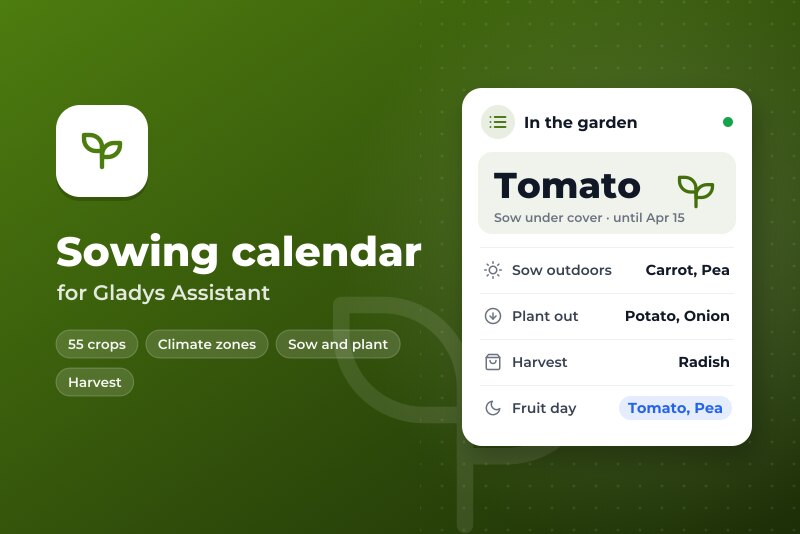
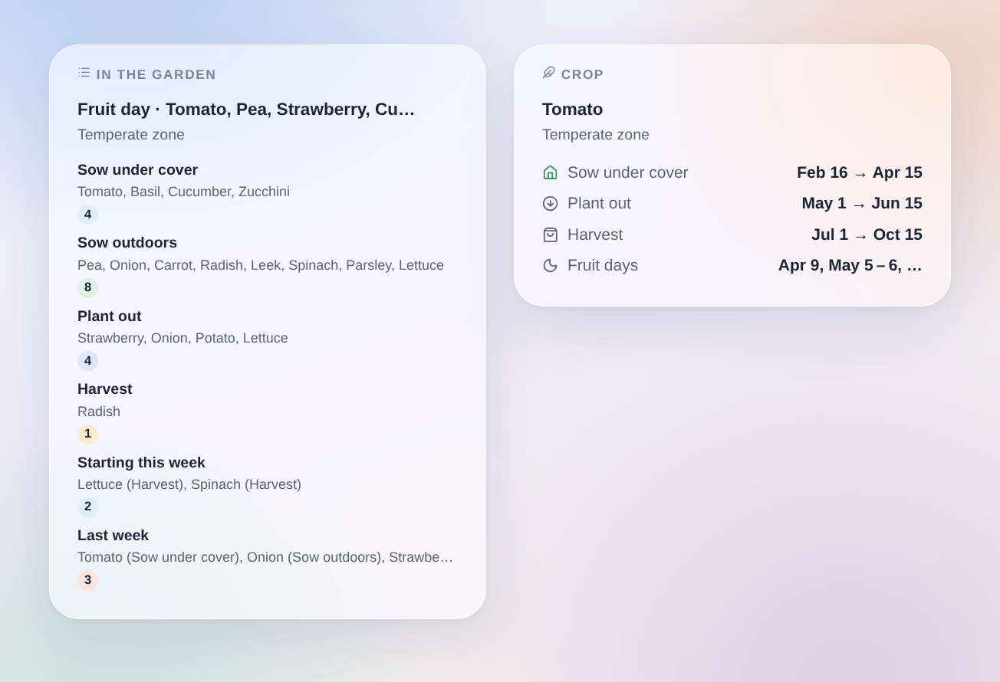
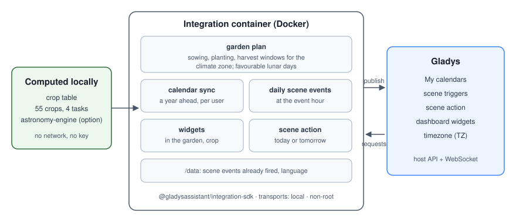
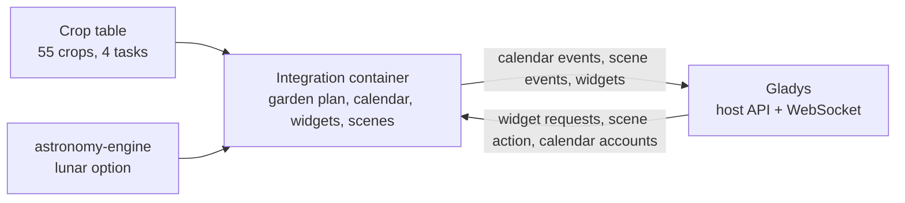
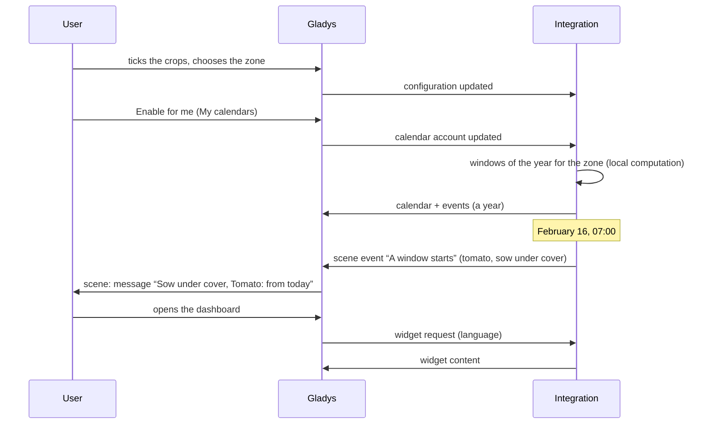

# Gladys Sowing calendar

**English** · [Français](README.fr.md) · [Deutsch](README.de.md) · [Español](README.es.md)

[](LICENSE)
[](https://github.com/William-De71/gladys-sowing-calendar/releases)
[](https://github.com/William-De71/gladys-sowing-calendar/actions/workflows/release.yml)
[](https://gladysassistant.com)



External integration for [Gladys Assistant](https://gladysassistant.com) that brings a sowing calendar for the kitchen garden: when to sow under cover, sow outdoors, plant out and harvest 55 vegetables and herbs, with dates adjusted to your climate. Everything is computed locally, with no account and no connection, and optionally with the favourable days of the lunar gardening calendar.

User documentation: [English](docs/en.md) · [Français](docs/fr.md) · [Deutsch](docs/de.md) · [Español](docs/es.md).

## Features

- A **“Sowing calendar”** in “My calendars” for every user who enables it: one event per crop and task over its whole window (“Sow under cover: Tomato”, February 16 to April 15), from a week back to a year ahead, in the language of each user.
- **55 crops** to tick (43 vegetables, 12 herbs) and **4 tasks**: sow under cover, sow outdoors, plant out, harvest.
- **Your climate**: five climate zones that move the spring and the autumn earlier or later, a fine adjustment in weeks, the southern hemisphere.
- **Optionally, the moon**: the fruit, root, flower or leaf days that suit each crop (Maria Thun method), days to avoid excluded.
- **Scene triggers** “Daily summary”, “A window starts” and “Last week of a window”, with filters. **Scene action** “Get the garden tasks” (today or tomorrow), with a ready-made sentence.
- **Widgets** “In the garden” (the tasks of the day) and “Crop” (the dates of one crop).
- Local only, four languages: English, French, German, Spanish.



| Type     | Name                  | Use                                                                     |
| -------- | --------------------- | ----------------------------------------------------------------------- |
| Calendar | Sowing calendar       | One window per crop and task, a year ahead                              |
| Widget   | In the garden         | The tasks in progress, what starts within the week, what ends           |
| Widget   | Crop                  | The dates of one crop, in progress or next, and its next lunar days     |
| Trigger  | Daily summary         | Every day at the chosen hour (filters: a window starts, lunar day type) |
| Trigger  | A window starts       | The first day of a window (filters: tasks, crops)                       |
| Trigger  | Last week of a window | Seven days before the end of a window (filters: tasks, crops)           |
| Action   | Get the garden tasks  | Today or tomorrow: 14 values and a summary sentence                     |

There are no devices: Gladys does not let a calendar integration publish devices, and a sowing window reads better in the calendar, the widgets and the scenes.

## How it works







The crop table (`src/crops.js`) gives, by half-month, the usual windows of French kitchen-garden calendars for a temperate climate. `src/plan.js` moves them by the zone (a date up to July 15 follows the spring shift, a later one the autumn shift), the fine adjustment and the hemisphere. The lunar option uses the almanac of the “Lunar gardening calendar” integration, checked day by day against a published calendar.

Transport: **local**. Nothing leaves your network.

## Prerequisites

- Gladys Assistant **5.3.0** or later (calendar integrations, catalog keywords of Gladys 5.3). Older instances cannot install it.
- The right timezone in Gladys: days change at midnight in this timezone.

## Installation

1. In Gladys, open **Integrations**, search for **Sowing calendar** and install it.
2. Tick your crops, choose your climate zone, then click **Enable for me** under **My calendars**; share the calendar with the household to use it in scenes.
3. Add the widgets to a dashboard, and create scenes with the triggers and the action. The settings are described in the [documentation](docs/en.md#configuration).

From the repository URL, or in developer mode: see the Gladys documentation on external integrations.

## Development

```bash
npm install
npm test                       # node --test, never touches the network
npm run lint && npm run format:check
npx github:GladysAssistant/integration-store . --skip-image-check
node scripts/sync-crops.mjs    # crop lists of the manifest from src/crops.js
scripts/build-cover.sh         # cover.jpg from docs/assets/cover.svg
docs/illustrations/render.sh   # docs/assets/widgets.<lang>.png
node .github/scripts/release.mjs next
```

Locally, the SDK reads `GLADYS_HOST_API_URL`, `GLADYS_INTEGRATION_TOKEN` and `GLADYS_INTEGRATION_SELECTOR`, and `TZ` sets the timezone of the days; `DEBUG=gladys-integration-sdk` prints the SDK logs and checks every widget content. The rules of the project are in [CLAUDE.md](CLAUDE.md).

## Release process


Every merge to `main` runs the CI, then computes the version from the [Conventional Commits](https://www.conventionalcommits.org/) since the last tag: `feat` → minor, `fix` / `perf` → patch, `!` or `BREAKING CHANGE` → major (minor before 1.0.0); `docs`, `chore`, `ci`, `test`, `style`, `refactor`, `build` alone publish nothing. The changelog section is generated, the tag pushed, the multi-architecture image built, then `main` gets the release commit, the GitHub Release is created and a last job checks the public image, the store validator and the topic.

- The title of the pull request becomes the squash commit, then the changelog line: write it in English, for the user (`pr-title.yml` checks it). Never edit `CHANGELOG.md` by hand.
- 1.0.0 is a decision: Actions → Release → Run workflow with `release-as: 1.0.0`. `dry-run` shows the version and the notes without publishing anything.
- The branch ruleset only forbids deletion and force-push: a rule that requires pull requests or status checks would block the release commit (let GitHub Actions bypass it, or use a GitHub App).
- After the first release, make the `ghcr.io` package public (Package settings → Change visibility), otherwise Gladys cannot pull it.

## Contributing

Issues and pull requests are welcome. Run `npm run format:check && npm run lint && npm test` before opening a pull request, and never change a stored key (crop keys, event ids, keys of the triggers and the action: see [CLAUDE.md](CLAUDE.md)). A date looks wrong for a crop: open an issue with the crop, the task and the dates you expect, with a source if you can.

## Security

See [SECURITY.md](SECURITY.md): report vulnerabilities privately. The integration has no secret, makes no network call and runs read-only, without root rights, in its container.

## License

[Apache-2.0](LICENSE). The lunar option uses [astronomy-engine](https://github.com/cosinekitty/astronomy) (MIT): see [NOTICE](NOTICE). Not affiliated with the Maria Thun publishers, Demeter or icalendrier.fr.
