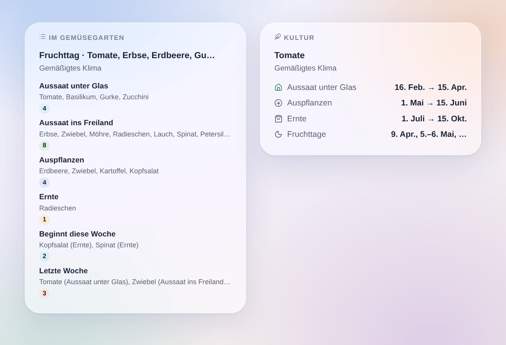

# Aussaatkalender

## Überblick

Ein Aussaatkalender für Ihren Gemüsegarten in Gladys: wann jede Kultur unter Glas oder ins Freiland gesät, ausgepflanzt und geerntet wird, mit Daten passend zu Ihrem Klima. Alles wird in der Integration selbst berechnet: kein Konto, kein Schlüssel, keine Verbindung.

- **55 Kulturen**: 43 Gemüse (Tomate, Möhre, Lauch, Kohl, Erdbeere…) und 12 Kräuter (Basilikum, Petersilie, Schnittlauch, Thymian…). Sie wählen die Ihres Gartens.
- **Daten für Ihr Klima**: eine Klimazone (Mittelmeer, mildes Seeklima, gemäßigt, kontinental, Berge), eine Feineinstellung in Wochen und die Südhalbkugel.
- **Optional der Mond**: die Tage des Mondkalenders für den Garten (Methode Maria Thun), die zu jeder Kultur passen, Wurzeltage für Möhren, Fruchttage für Tomaten…

Sie erhalten einen Kalender unter **Meine Kalender**, zwei Dashboard-Widgets, drei Szenenauslöser und eine Szenenaktion.

## Voraussetzungen

- Gladys Assistant 5.3.0 oder neuer.
- Die richtige Zeitzone in Gladys (Einstellungen → System): Die Tage wechseln um Mitternacht in dieser Zeitzone.

## Konfiguration

1. Installieren Sie die Integration unter **Integrationen** (Sowing calendar).
2. Wählen Sie die Kulturen Ihres Gartens und Ihre Klimazone.
3. Klicken Sie unter **Meine Kalender** auf **Für mich aktivieren**: Der „Aussaatkalender“ erscheint in Ihren Kalendern. Um ihn in Szenen zu nutzen, öffnen Sie ihn unter **Kalender** und teilen Sie ihn mit dem Haushalt.

| Feld                      | Standard            | Wirkung                                                                                                                 |
| ------------------------- | ------------------- | ----------------------------------------------------------------------------------------------------------------------- |
| Kulturen des Gartens      | 16 gängige Kulturen | Kalender, Widgets und Szenen folgen diesen Kulturen.                                                                    |
| Klimazone                 | Gemäßigt            | Verschiebt die Bezugsdaten (siehe unten).                                                                               |
| Feineinstellung (Wochen)  | 0                   | Wochen, die zu allen Daten addiert werden, −4 bis 4: positiv für eine Frostsenke, negativ für einen geschützten Garten. |
| Halbkugel                 | Nord                | Süden: alle Daten sechs Monate später.                                                                                  |
| Arbeiten im Kalender      | alle vier           | Aussaat unter Glas, Aussaat ins Freiland, Auspflanzen, Ernte. Widgets und Szenen zeigen immer alles.                    |
| Günstige Mondtage         | nein                | Fügt die Mondtage hinzu, die zu jeder Kultur passen (lokal berechnet, etwa eine Sekunde pro Jahr).                      |
| Stunde der Szenenauslöser | 7                   | Die Auslöser starten jeden Tag zu dieser Stunde (0 bis 23).                                                             |
| Sprache der Texte         | Automatisch         | Szenentexte und Status. Der Kalender folgt immer der Sprache jedes Benutzers.                                           |

Die Bezugsdaten sind die eines gemäßigten Klimas: nördliche Hälfte Frankreichs, Belgien, Schweizer Mittelland, Süddeutschland. Eine wärmere Zone beginnt das Frühjahr früher und beendet den Herbst später, eine kältere umgekehrt: Ein Datum bis zum 15. Juli folgt der Frühjahrsverschiebung, ein späteres der Herbstverschiebung.

| Zone            | Frühjahr        | Herbst          |
| --------------- | --------------- | --------------- |
| Mittelmeer      | 3 Wochen früher | 3 Wochen später |
| Mildes Seeklima | 1 Woche früher  | 2 Wochen später |
| Gemäßigt        | Bezugsdaten     | Bezugsdaten     |
| Kontinental     | 1 Woche später  | 1 Woche früher  |
| Berge           | 3 Wochen später | 3 Wochen früher |

## Verwendung

### Kalender

- „Aussaat unter Glas: Tomate“ vom 16. Februar bis 15. April: ein ganztägiges Ereignis pro Kultur und Arbeit über den ganzen Zeitraum, mit den Daten, der Zone, dem Tipp zur Arbeit und, mit der Mondoption, den günstigen Tagen des Zeitraums in der Beschreibung.
- Mit allen Kulturen und Arbeiten etwa 190 Zeiträume im Jahr: Wählen Sie Arbeiten ab (zum Beispiel die Ernte) für einen leichteren Kalender.

Der Kalender umfasst die vergangene Woche und das kommende Jahr. Er rückt jede Nacht vor. Eine neue Zone verschiebt die Ereignisse, ohne sie zu verdoppeln.

### Widgets

- **Im Gemüsegarten**: eine Karte pro laufender Arbeit (die Kulturen; bis wann, wenn Sie die Karte antippen), was innerhalb der Woche beginnt und was in seine letzte Woche geht. Mit der Mondoption der Tagestyp als Titel und die Kulturen, die er begünstigt.
- **Kultur** (Einstellung „Kultur“): jede Arbeit einer Kultur mit ihren Daten, grün während sie läuft, und mit der Mondoption die nächsten günstigen Tage.

### Szenen

Auslöser, jeden Tag zur Stunde der Konfiguration:

- **Tageszusammenfassung**: die Arbeiten im Garten. Filter: ein Zeitraum beginnt oder nicht, der Mondtagestyp. Variablen: dieselben Werte wie bei der Aktion unten, außer `has_opening`.
- **Ein Zeitraum beginnt**: der erste Tag des Zeitraums einer Kultur und einer Arbeit. Filter: die Arbeiten, die Kulturen. Variablen: `crop`, `crop_label`, `task` (sow_indoors, sow_outdoors, plant_out, harvest), `task_label`, `start`, `end`, `end_label`, `lunar_days`, `summary`.
- **Letzte Woche eines Zeitraums**: sieben Tage vor dem Ende eines Zeitraums von zwei Wochen oder mehr. Dieselben Filter und Variablen.

Aktion **Gartenarbeiten abrufen** (heute oder morgen): `date`, `sow_indoors`, `sow_outdoors`, `plant_out`, `harvest` (die Kulturen jeder Arbeit), `task_count`, `opening`, `has_opening` (yes, no), `closing`, `day_type` (fruit, root, flower, leaf), `day_type_label`, `avoid` (yes, no), `favourable`, `summary`.

Beispiele:

- „Ein Zeitraum beginnt“, Filter Arbeit = Aussaat unter Glas → „{{triggerEvent.data.summary}}“ senden: „Aussaat unter Glas, Tomate: ab heute bis 15. Apr.“
- „Letzte Woche eines Zeitraums“, Filter Kultur = Knoblauch → Erinnerung „Letzte Woche, um den Knoblauch zu pflanzen“.
- Jeden Sonntag um 9 Uhr (geplante Szene) → „Gartenarbeiten abrufen“ → die Ausgabe „Zusammenfassung“ in einer Nachricht senden.

### Transport

Nur lokal: Alles wird im Container berechnet, nichts verlässt Ihr Netzwerk. Der Katalog zeigt das Abzeichen „lokal“.

## Wie es berechnet wird

- Die Tabelle der Kulturen gibt pro Halbmonat die üblichen Zeiträume französischer Gartenkalender für ein gemäßigtes Klima an. Es sind Richtwerte: Witterung des Jahres, Sorte und Lage zählen ebenso.
- Jedes Datum wird nach der Zone verschoben (Frühjahr oder Herbst), dann um die Feineinstellung; die Südhalbkugel fügt sechs Monate hinzu. Ein Zeitraum behält mindestens eine Woche.
- Die Mondoption nutzt die Berechnung der Integration „Lunar gardening calendar“: Der Typ eines Tages ist der längste Typ des Tages (Sternbild des Mondes), ohne ungünstige Tage (Erdnähe, Erdferne, Mondknoten, Finsternis). Tag für Tag mit dem von icalendrier.fr veröffentlichten Kalender 2026 geprüft.

## Fehlerbehebung

- **Kein Kalender**: Klicken Sie auf der Seite der Integration unter **Meine Kalender** auf **Für mich aktivieren**. Ein nicht geteilter Kalender erscheint nicht in Szenen: Teilen Sie ihn mit dem Haushalt.
- **Die Daten passen nicht zu Ihrem Garten**: Wechseln Sie die Zone oder nutzen Sie die Feineinstellung, die für alle Daten gilt. Eine Kultur scheint falsch: Eröffnen Sie ein Issue mit der Kultur, der Arbeit und den erwarteten Daten.
- **Die Tageszusammenfassung startet nicht**: Sie startet einmal am Tag, zur eingestellten Stunde oder in der ersten Minute danach. Nach einem Neustart am selben Tag startet sie nicht erneut.
- Protokolle: der Reiter **Protokolle** der Integration. Im Entwicklermodus fügt `DEBUG=gladys-integration-sdk` die Protokolle des SDK hinzu.
