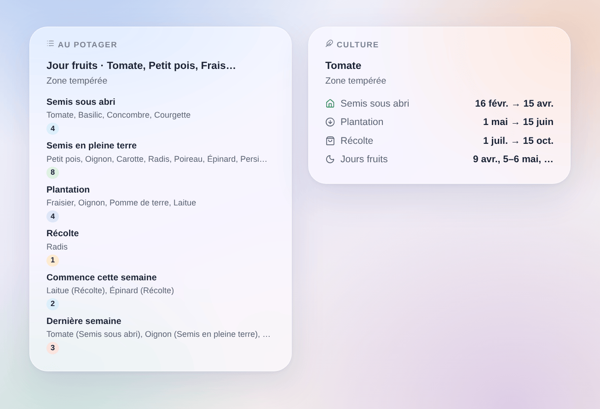

# Calendrier des semis

## Présentation

Un calendrier des semis pour votre potager dans Gladys : quand semer sous abri, semer en pleine terre, planter et récolter chaque culture, avec des dates adaptées à votre climat. Tout est calculé dans l’intégration elle-même : aucun compte, aucune clé, aucune connexion.

- **55 cultures** : 43 légumes (tomate, carotte, poireau, chou, fraisier…) et 12 aromatiques (basilic, persil, ciboulette, thym…). Vous cochez celles de votre potager.
- **Des dates adaptées à votre climat** : une zone climatique (méditerranéenne, océanique douce, tempérée, continentale, montagne), un réglage fin en semaines et l’hémisphère sud.
- **En option, la lune** : les jours du calendrier lunaire du jardinier (méthode Maria Thun) qui conviennent à chaque culture, jours racines pour les carottes, jours fruits pour les tomates…

Vous obtenez un calendrier dans **Mes calendriers**, deux widgets de tableau de bord, trois déclencheurs de scène et une action de scène.

## Prérequis

- Gladys Assistant 5.3.0 ou plus récent.
- Le bon fuseau horaire dans Gladys (Paramètres → Système) : les jours changent à minuit dans ce fuseau.

## Configuration

1. Installez l’intégration depuis **Intégrations** (Sowing calendar).
2. Cochez les cultures de votre potager et choisissez votre zone climatique.
3. Sous **Mes calendriers**, cliquez sur **Activer pour moi** : le « Calendrier des semis » apparaît dans vos calendriers. Pour l’utiliser dans les scènes, ouvrez-le dans **Calendriers** et partagez-le avec le foyer.

| Champ                           | Par défaut            | Effet                                                                                                          |
| ------------------------------- | --------------------- | -------------------------------------------------------------------------------------------------------------- |
| Cultures du potager             | 16 cultures courantes | Le calendrier, les widgets et les scènes suivent ces cultures.                                                 |
| Zone climatique                 | Tempérée              | Décale les dates de référence (voir ci-dessous).                                                               |
| Réglage fin (semaines)          | 0                     | Semaines ajoutées à toutes les dates, −4 à 4 : positif pour un coin gélif, négatif pour un jardin abrité.      |
| Hémisphère                      | Nord                  | Sud : toutes les dates six mois plus tard.                                                                     |
| Tâches dans le calendrier       | les quatre            | Semis sous abri, semis en pleine terre, plantation, récolte. Les widgets et les scènes montrent toujours tout. |
| Jours lunaires favorables       | non                   | Ajoute les jours de la lune qui conviennent à chaque culture (calcul local, environ une seconde par an).       |
| Heure des déclencheurs de scène | 7                     | Les déclencheurs démarrent chaque jour à cette heure (0 à 23).                                                 |
| Langue des textes               | Automatique           | Textes des scènes et état. Le calendrier suit toujours la langue de chaque utilisateur.                        |

Les dates de référence sont celles d’un climat tempéré : moitié nord de la France, Belgique, plateau suisse, sud de l’Allemagne. Une zone plus chaude avance le printemps et prolonge l’automne, une zone plus froide fait l’inverse : une date jusqu’au 15 juillet suit le décalage de printemps, une date plus tardive celui d’automne.

| Zone            | Printemps            | Automne              |
| --------------- | -------------------- | -------------------- |
| Méditerranéenne | 3 semaines plus tôt  | 3 semaines plus tard |
| Océanique douce | 1 semaine plus tôt   | 2 semaines plus tard |
| Tempérée        | dates de référence   | dates de référence   |
| Continentale    | 1 semaine plus tard  | 1 semaine plus tôt   |
| Montagne        | 3 semaines plus tard | 3 semaines plus tôt  |

## Utilisation

### Calendrier

- « Semis sous abri : Tomate » du 16 février au 15 avril : un événement sur la journée par culture et par tâche, sur toute sa période, avec les dates, la zone, le conseil de la tâche et, avec l’option lunaire, les jours favorables de la période dans sa description.
- Avec toutes les cultures et toutes les tâches, environ 190 périodes sur un an : décochez des tâches (la récolte, par exemple) pour un calendrier plus léger.

Le calendrier couvre la semaine passée et l’année à venir. Il avance chaque nuit. Changer de zone déplace les événements, sans les dupliquer.

### Widgets

- **Au potager** : une carte par tâche en cours (les cultures, jusqu’à quand en touchant la carte), ce qui commence dans la semaine et ce qui entre dans sa dernière semaine. Avec l’option lunaire, le type de jour en titre et les cultures qu’il favorise.
- **Culture** (réglage « Culture ») : chaque tâche d’une culture avec ses dates, en vert quand elle est en cours, et avec l’option lunaire ses prochains jours favorables.

### Scènes

Déclencheurs, chaque jour à l’heure de la configuration :

- **Résumé du jour** : ce qu’il y a à faire au potager. Filtres : une période commence ou non, le type de jour lunaire. Variables : les mêmes valeurs que l’action ci-dessous, sauf `has_opening`.
- **Une période commence** : le premier jour de la période d’une culture et d’une tâche. Filtres : les tâches, les cultures. Variables : `crop`, `crop_label`, `task` (sow_indoors, sow_outdoors, plant_out, harvest), `task_label`, `start`, `end`, `end_label`, `lunar_days`, `summary`.
- **Dernière semaine d’une période** : sept jours avant la fin d’une période de deux semaines ou plus. Mêmes filtres et variables.

Action **Obtenir les travaux du potager** (aujourd’hui ou demain) : `date`, `sow_indoors`, `sow_outdoors`, `plant_out`, `harvest` (les cultures de chaque tâche), `task_count`, `opening`, `has_opening` (yes, no), `closing`, `day_type` (fruit, root, flower, leaf), `day_type_label`, `avoid` (yes, no), `favourable`, `summary`.

Exemples :

- « Une période commence », filtre tâche = semis sous abri → envoyer « {{triggerEvent.data.summary}} » : « Semis sous abri, Tomate : à partir d’aujourd’hui, jusqu’au 15 avr. »
- « Dernière semaine d’une période », filtre culture = ail → rappel « Dernière semaine pour planter l’ail ».
- Chaque dimanche à 9 h (scène planifiée) → « Obtenir les travaux du potager » → envoyer la sortie « Résumé » dans un message.

### Transport

Local uniquement : tout est calculé dans le conteneur, rien ne sort de votre réseau. Le catalogue affiche le badge « local ».

## Comment c’est calculé

- Le tableau des cultures donne, par quinzaine, les périodes habituelles des calendriers de potager français pour un climat tempéré. Ce sont des repères : la météo de l’année, la variété et l’exposition comptent autant.
- Chaque date est décalée selon la zone (printemps ou automne), puis du réglage fin ; l’hémisphère sud ajoute six mois. Une période garde au moins une semaine.
- L’option lunaire reprend le calcul de l’intégration « Calendrier lunaire du jardinier » : le type d’un jour est le type le plus long de la journée (constellation de la lune), hors jours à éviter (périgée, apogée, nœud lunaire, éclipse). Vérifié jour par jour avec le calendrier 2026 publié par icalendrier.fr.

## Dépannage

- **Pas de calendrier** : cliquez sur **Activer pour moi** sous **Mes calendriers** sur la page de l’intégration. Un calendrier non partagé n’apparaît pas dans les scènes : partagez-le avec le foyer.
- **Les dates ne collent pas à votre jardin** : changez de zone ou utilisez le réglage fin, qui s’applique à toutes les dates. Une culture précise vous semble fausse : ouvrez une issue avec la culture, la tâche et les dates que vous attendez.
- **Le résumé du jour ne démarre pas** : il démarre une fois par jour, à l’heure configurée ou à la première minute qui suit. Il ne redémarre pas après un redémarrage le même jour.
- Journaux : l’onglet **Journaux** de l’intégration. En mode développeur, `DEBUG=gladys-integration-sdk` ajoute les journaux du SDK.
